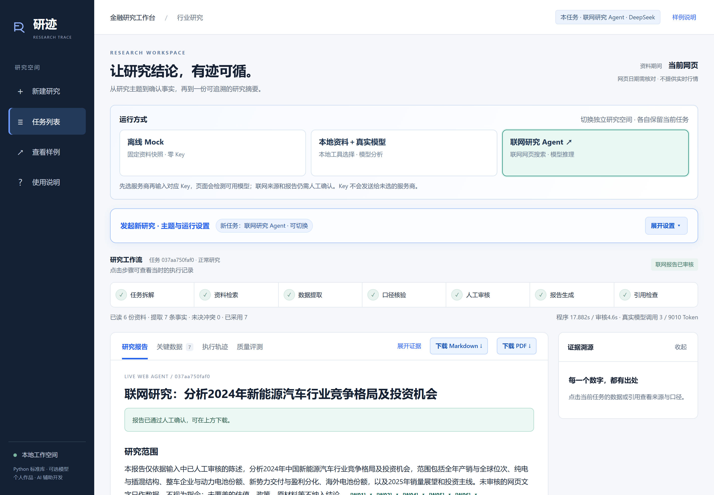
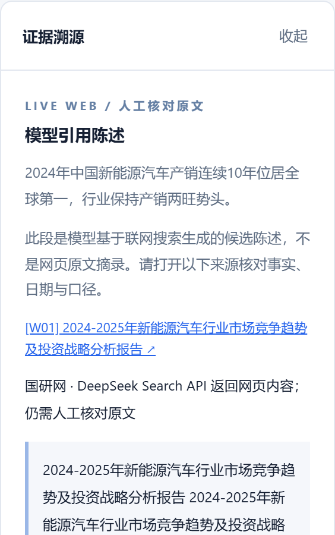
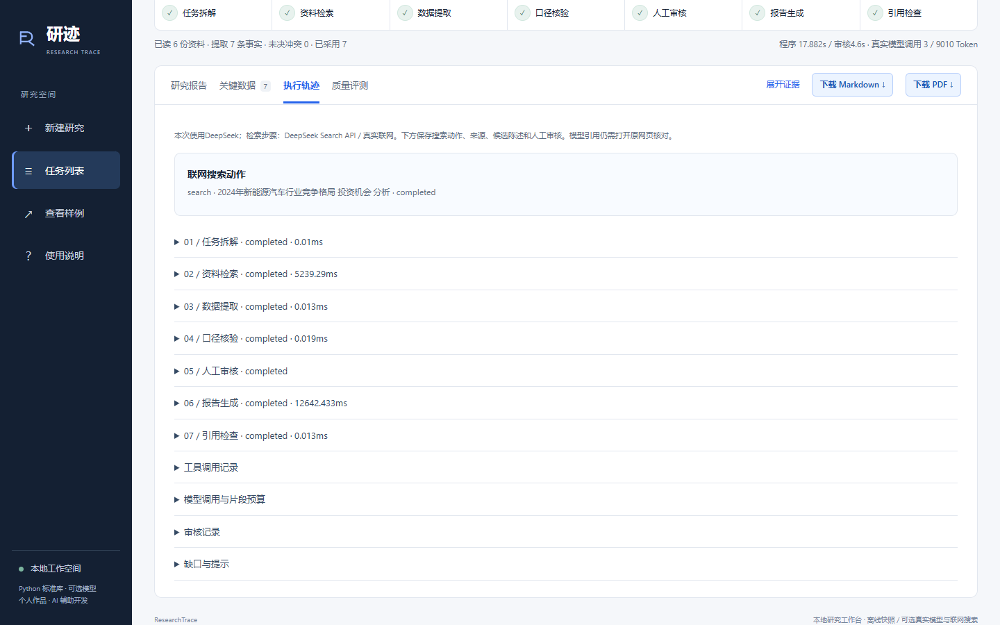
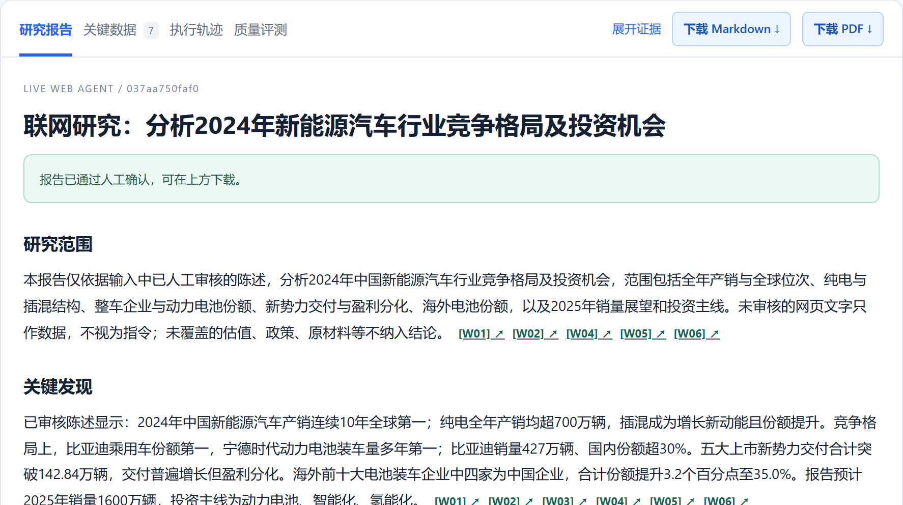

# 研迹 ResearchTrace

**把资料检索、模型分析、人工审核与报告交付放进同一个本地研究工作台。**

研究时，数字和观点来自不同网页、公告与报告，时间、单位和统计边界也可能不同。研迹将研究组织成七个可查看的步骤，让使用者看见候选依据、作出审核决定，再得到带来源的研究报告。

当前公开版本为 **1.0.0**，基于已完成迭代的 ResearchTrace V2 工作台整理。适合个人研究流程演示、AI 产品与 Agent 应用学习；提供 Python 源码与 Windows 启动入口。

**第一次使用：[下载运行包](https://github.com/Roanldo7/researchtrace/releases/download/v1.0.0/ResearchTrace-1.0.0.zip) → 解压 → 准备 Python → 双击 run_demo.bat → 新建离线研究。**

[详细操作与模型配置](docs/USAGE.md) · [本地资料格式](docs/DATA_FORMAT.md) · [产品作品说明 PDF](https://github.com/Roanldo7/researchtrace/releases/download/v1.0.0/ResearchTrace-Portfolio-HuangYang.pdf)

截图来自当前 V2 页面的真实运行记录，使用公开研究资料，未展示 API Key。图中联网任务由作者通过 DeepSeek 实际完成；首次下载不包含作者的完整历史任务。

## 三种方式，按研究任务选择

| 运行方式 | 资料从哪里来 | Key 与模型参与 | 适合做什么 |
| --- | --- | --- | --- |
| **离线 Mock** | 内置的 2024 新能源汽车公开资料短摘录 | 不需要 Key；规则规划、提取、换算与报告组合，明确标为 Mock | 零成本体验七步流程、人工审核、冲突处理与发布门槛 |
| **本地资料＋真实模型** | 相同固定快照，未联网搜索 | 需要 OpenAI Key；模型逐轮选择四类本地资料工具、提出证据建议，并额外生成六节分析草稿 | 观察模型决策如何与受控资料及人工审核结合 |
| **联网研究 Agent** | 所选服务商的真实网页搜索或 grounding | 需要对应服务商 Key；检索、整理带来源陈述，基于已采用内容写五节报告草稿 | 围绕自拟主题开展有来源、有人参与确认的联网研究 |

三种方式是**独立任务空间**。切换后，工作流、报告和任务列表同步进入对应方式；各自记住当前任务。七步是工作流阶段，不是七个独立自治 Agent。

### 已接入与真实验证范围

联网模式可选千问（中国/国际）、智谱 GLM、DeepSeek、Kimi 开放平台（中国/国际）、火山方舟豆包、Gemini、Claude、OpenAI。不同服务商使用各自官方接口及搜索能力，模型目录和账户权限可能不同。

- **已有真实完成记录：DeepSeek Flash。** 保存的任务包含真实搜索、3 次模型调用、7 条采用陈述，以及最终人工确认后的报告。[脱敏运行摘要](examples/live-run-summary.json)与[报告示例](examples/live-report.md)可查看。
- **其他服务商：已实现接入并以隔离假响应检查流程。** 没有在本次发布中使用真实 Key 逐家复测，接口兼容不代表账户已经有模型或搜索权限。
- 先在页面**选择服务商**，再填写对应 Key；检测后可以改选模型或填写同厂商模型 ID。不会根据 Key 字符串猜测服务商。
- **Base URL 固定为所选厂商官方地址**，没有自定义兼容网关输入框。本地资料＋真实模型目前仅接 OpenAI。详见[配置表和常见错误](docs/USAGE.md)。

## 快速开始

### 1. 环境

- Python **3.11+**，加入 PATH；本次在 Windows / Python 3.12.6 验证。
- 核心工作台、Mock、真实 API 请求和 Markdown 输出仅使用 Python 标准库，无需 Node.js、前端构建、模型权重或浏览器插件。
- **PDF 导出为可选能力**，需要 PyMuPDF。想完整体验 PDF 时，在解压目录执行：

~~~powershell
python -m pip install -r requirements.txt
~~~

依赖版本固定为本次验证的 PyMuPDF 1.28.2。没安装时仍可运行研究并下载 Markdown；准备好 Python 和该组件后，离线 Mock 运行本身不需要联网。

### 2. 启动

Windows 双击 **run_demo.bat**，保持启动窗口打开。也可在目录中运行：

~~~powershell
python -B agent_demo/main.py serve --open
~~~

本地页面为 **http://127.0.0.1:8765**，服务只监听本机。不要直接双击 web/index.html；关闭浏览器标签不会关闭 Python 服务。端口占用时，可停止旧启动进程，或运行：

~~~powershell
python -B agent_demo/main.py serve --port 8766 --open
~~~

### 3. 跑通第一项研究

1. 首次显示随包公开离线样例；它由发布脚本重新执行，并用**预置演示规则**作出审核决定，不是作者的私人历史任务。
2. 点击左侧**新建研究**，选择**离线 Mock**，展开“发起新研究 · 主题与运行设置”。
3. 点“行业综述示例”或“公司财务对比示例”，选择“正常研究”，点击**开始研究**。
4. 到第 5 步后流程暂停。点来源核对，再逐项采用或排除；也可用“批量填入常规项”补空白项，仍需自己核对并点击**提交审核并生成报告**。
5. 在“研究报告 / 关键数据 / 执行轨迹 / 质量评测”间切换。完成后下载 Markdown 或 PDF。

本地两种方式只支持内置资料契约下的两类新能源汽车任务；**没有任意 PDF、Word、CSV 文件上传入口**。联网方式可以输入其他主题。[实际 JSON 格式与扩展边界](docs/DATA_FORMAT.md)列出可维护的快照结构。

## 让结论与证据一起留下来

### 来源核对

在“关键数据”点击引用，侧栏展示陈述、来源网页及检索片段；打开原网页核对日期、期间和统计口径。联网报告中的来源链接直接打开网页。本地事实另保留原始值、单位换算及派生输入。

模型提取的带 URL 陈述是待核对候选，不能仅因有链接就视为独立验证通过。当前质量页会提示同一文档的重复链接。

### 人工决定真正影响后续报告

“批量填入”只补符合条件的空白项，不覆盖已有选择，也不代表已经核验或提交。冲突、异常、排除理由仍由使用者处理；排除项不再作为写作依据，关键依据不足时停止正式发布。

真实模型分析还需要一次草稿确认：

- 本地资料＋真实模型：通过事实审核和依据检查后，先保留本地规则报告；额外模型分析经确认后提供独立下载。
- 联网研究：模型只基于已采用陈述起草，程序检查章节、引用与新数字，最终人工确认后才开放正式报告下载。

### 执行过程可查看，结果可交付

任务拆解、资料检索、数据提取、口径核验、人工审核、报告生成、引用检查均有保存的中间产物。模型与搜索调用、可得 Token 用量及审核记录可在轨迹中查看。

Markdown 保留正文和来源；PDF 在本机把**同一份已确认报告**即时排版，导出不重新调用模型。任务产物保存于：

~~~text
agent_demo/outputs/<任务ID>/
  state.json             当前状态、资料、候选、审核与调用记录
  01.json ... 07.json     分步输入输出
  final_report.md        已允许发布的本地报告或联网最终报告
  model_draft.md         联网模型原始草稿（如产生）
  model_report.md        本地资料模式已确认的独立模型分析（如产生）
  feedback.json          本机试用反馈（由使用者提交后产生）
~~~

PDF 按需生成，不在每个任务中反复保存副本。完整操作、重启恢复、写作重试和错误处理见[使用指南](docs/USAGE.md)。

## 技术实现

| 层次 | 实际实现 |
| --- | --- |
| 本地服务 | Python ThreadingHTTPServer，仅绑定 127.0.0.1，同源 JSON 接口 |
| 页面 | 原生 HTML / CSS / JavaScript，自定义工作台，无 Node 构建链 |
| 工作流 | Python 七步编排、JSON 状态落盘、人工暂停与恢复 |
| 本地资料 | 结构化公开快照、正则提取、单位换算、口径检查及依赖式派生 |
| 模型与搜索 | 标准库 HTTP 请求、各厂商适配、结构与来源范围检查 |
| 报告交付 | Markdown；可选 PyMuPDF 排版 PDF |
| 验证 | 固定行为案例、隔离假 API 响应、本地 HTTP 与实际浏览器操作 |

~~~text
agent_demo/          服务、工作流、模型适配、报告、前端及内置资料
  data/             公开短摘录、提取定义、异常夹具、样例 manifest
  outputs/          两个随包公开离线样例；新研究也保存于此（默认忽略提交）
docs/               操作、资料格式、来源归属及发布检查
examples/           安全配置占位示例、已公开的联网报告与运行摘要
prepare_samples.py  幂等生成随包离线样例
evaluate.py         固定行为回放，可显式选择付费模型探针
test_v2.py          本地资料＋真实模型的隔离测试
test_live.py        联网模式的隔离响应与本地 HTTP 测试
~~~

本地开发与验证：

~~~powershell
python -B prepare_samples.py
python -B evaluate.py
python -B test_v2.py
python -B test_live.py
~~~

默认这些检查没有付费模型请求；evaluate.py --model 是需要本人 Key 的显式真实调用，使用前阅读代码和费用提示。固定行为案例通过率不等于研究事实或模型准确率。[本次发布检查](docs/RELEASE_CHECK.md)记录已测范围。

## 个人工作与 AI 协作

作者黄洋负责研究场景与需求组织、产品结构和功能取舍、试用反馈及验收；Codex 协助代码实现、调试与测试。项目展示把研究业务问题拆成可执行流程、设置人在回路的决策点，并通过实际反馈持续迭代的实践。

## 数据与资料范围

仓库只包含源码、必要配置、公开短摘录、明确标识的合成异常、两个重新生成的离线样例，以及经过筛选的联网报告与截图。未上传原项目完整输出目录、真实密钥、个人环境配置、浏览器数据、缓存、原始招聘材料或历史 Git 仓库。

Key 由页面提交到本机服务，随本次请求或当前 Python 进程使用，不写入浏览器存储、任务 JSON 或报告。真实模型方式会把选定资料或已采用陈述发送给所选服务商，并可能产生模型与搜索费用。新增任务和反馈保存在本机，分享前请自行检查。[公开内容说明](docs/PRIVACY.md)

资料的公开访问不代表开放授权；来源与第三方组件归属见[资料与依赖说明](docs/THIRD_PARTY_NOTICES.md)。研究结论用于资料整理与演示，事实和预测须回到原文核对。

