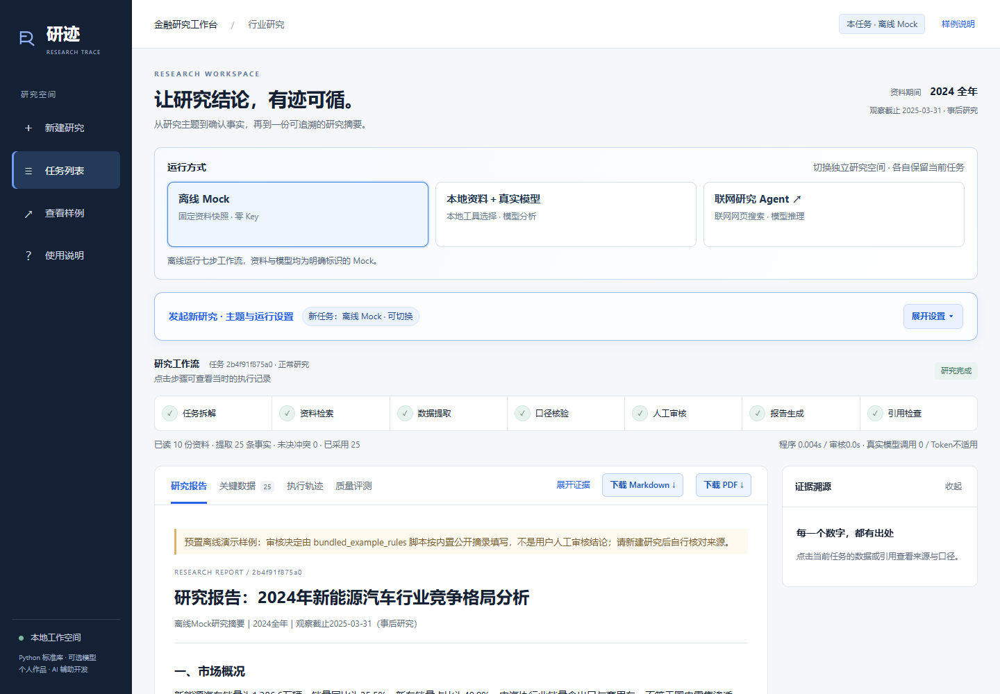
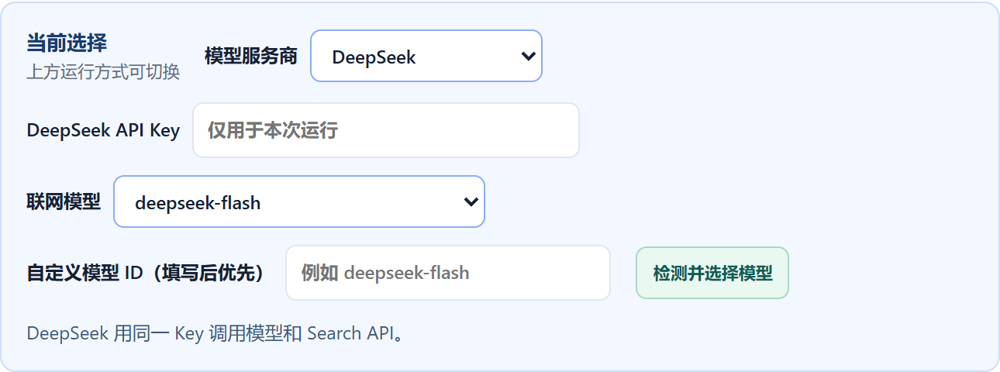

# 使用与配置指南

[返回项目介绍](../README.md) · [本地资料格式](DATA_FORMAT.md)

## 1. 下载与启动

从 [Releases](https://github.com/Roanldo7/researchtrace/releases) 下载运行包并完整解压；也可下载仓库源码。不要在 ZIP 内直接运行文件。

- Python **3.11 或更高版本**，安装时将 Python 加入 PATH。
- Chrome、Edge 或其他现代浏览器。
- 离线 Mock 与 Markdown 导出只使用 Python 标准库，无需 Node.js、模型权重或前端构建。
- **PDF 导出为可选依赖**，需要在项目根目录安装 `requirements.txt` 中的 PyMuPDF：

```powershell
python --version
python -m pip install -r requirements.txt
```

Windows 双击根目录 `run_demo.bat`。也可在根目录打开终端执行：

```powershell
python -B agent_demo/main.py serve --open
```

浏览器打开 **http://127.0.0.1:8765**。请保持启动终端运行；关闭终端即停止本地服务。不要直接打开 `agent_demo/web/index.html`，页面需要 Python 后端。

应用仅监听本机回环地址，不是多人在线服务。运行时新任务自动保存到 `agent_demo/outputs/<任务ID>/`；首次使用不依赖作者电脑上的路径、账号或历史任务。

首次打开会载入随包重新生成的离线正常样例，页面明确标出预置审核决定；它不代表你已经核查过资料。点“新建研究”开始自己的任务。



## 2. 三种运行方式的差别

| 运行方式 | 资料来源 | Key 与模型 | 模型参与的环节 | 适合用途 |
| --- | --- | --- | --- | --- |
| 离线 Mock | 内置 2024 新能源汽车公开资料摘录快照 | 无需 Key；MockLLM 为确定性规则契约 | 无真实模型调用；规则执行规划、抽取、换算与报告组合 | 第一次体验七步流程、证据与审核机制；可完全离线运行 |
| 本地资料＋真实模型 | 与 Mock 相同的固定快照，不联网搜索 | 当前仅接入 OpenAI，需 OpenAI API Key | 最多四轮选择本地资料工具，核对候选事实，并在人工事实审核后起草独立模型分析 | 观察模型工具选择、来源建议和基于固定证据的分析 |
| 联网研究 Agent | 所选服务商真实网页搜索或 grounding 返回的资料 | 选择服务商、填写其 Key、选择模型 | 真实搜索、候选陈述生成和基于已采用陈述的报告写作 | 用其他研究主题开展有来源的公开网页研究 |

七步流程是“任务拆解 → 资料检索 → 数据提取 → 口径核验 → 人工审核 → 报告生成 → 引用检查”，并非七个独立自主 Agent。

### 本地模式的主题范围

前两种模式只支持两类受控任务，可直接点击主题区的示例入口：

1. **行业综述示例**：`分析2024年新能源汽车行业竞争格局及投资机会`。
2. **公司财务对比示例**：`分析2024年新能源汽车行业重点公司财务表现`。

两类任务使用同一套快照，但章节结构和最低发布依据不同。研究期间为 2024 全年，观察截止日为 2025-03-31，属于事后研究。修改主题文字不会扩充资料库；任意行业、实时行情和未来预测须使用联网模式并核对来源。内置资料不是每次启动自动更新的数据。

### 联网服务商与已验证范围

界面支持通义千问（中国／国际）、智谱 GLM、DeepSeek、Kimi 开放平台（中国／国际）、火山方舟豆包、Google Gemini、Anthropic Claude、OpenAI。各路径按服务商提供的搜索接口或工具接入，返回资料格式会统一为来源、候选陈述、工具动作与调用记录。

| 服务商 | 本版接入的联网路径 |
| --- | --- |
| 通义千问 | 百炼 Responses `web_search`、`web_extractor` |
| 智谱 GLM | Web Search API |
| DeepSeek | 模型规划查询 + Search API |
| Kimi | Web Search Pro |
| 火山方舟豆包 | Responses `web_search` |
| Gemini | Google Search grounding |
| Claude | 网页搜索工具 |
| OpenAI | Responses `web_search` |

作者已保存的真实运行证据为 **DeepSeek** 的联网搜索、模型写作和两次人工审核。其他服务商已实现接口适配并有隔离假响应测试，不能据此视为全部完成真实账户端到端验证。模型目录可见也不代表账户拥有对应推理、搜索或地域权限；实际可用性由所选账户和运行结果决定。

## 3. 第一次研究：无需 Key

1. 进入页面，选择顶部 **离线 Mock**。
2. 展开 **研究主题与运行设置**，点击“行业综述示例”，选择正常场景。
3. 点击 **开始研究**。七步栏显示实际步骤，执行轨迹与候选事实会保存，不是播放预设进度。
4. 在 **关键事实待确认** 中，点开事实查看右侧来源、摘录、统计口径、单位换算和事实类型。
5. 可点击 **批量填入常规项** 减少逐项点选；逐项核对已填决定，处理剩余冲突、排除项和理由。
6. 点击 **提交审核并生成报告**。已排除事实不会进入写作上下文；核心依据不足时只显示缺口，不发布正式报告。
7. 在 **研究报告** 阅读结果，点击引用查看证据。通过检查后可下载 Markdown；安装 PDF 依赖后可直接下载同内容的 PDF。

“异常场景”用于演示受控超时重试与注入冲突，其中合成测试候选不可被采用为真实事实。它不是另一套真实市场数据。

## 4. 在页面配置真实模型



### 联网研究 Agent

在顶部选择 **联网研究 Agent**，展开研究设置：

| 配置项 | 在哪里填写 | 要求 |
| --- | --- | --- |
| 研究主题 | 主题输入区 | 必填，1—180 字；应明确期间、对象和研究问题 |
| 模型服务商 | “模型服务商”下拉框 | 必选；先按 Key 的真实归属选服务商和地域，不会从 Key 字符串自动猜测 |
| API Key | 服务商下方的密码输入框 | 必填，使用对应开放平台的 Key |
| 联网模型 | 点击“检测并选择模型”后在下拉框选择 | 必选；可改选更适合成本和能力要求的可用型号 |
| 自定义模型 ID | “自定义模型 ID（填写后优先）” | 可选；需符合所选服务商的模型命名与接口能力，填写后优先于下拉框 |
| Base URL | 无输入入口 | 代码固定到所选服务商官方域名；当前不支持自定义代理、网关或 OpenAI-compatible Base URL |

点击 **检测并选择模型** 后查看检测说明，再选择模型并开始研究。部分服务商读取模型目录，部分服务商用一次短请求验证推荐型号；**智谱、Kimi、豆包的检测本身可能产生模型费用**。目录未列出或标注运行时验证的型号，仍须在实际研究调用中验证能力。自定义模型 ID 不会绕过前置服务商检测，也不保证任意型号都能完成本工作流。

Kimi 需要开放平台 Key，Kimi Code 会员 Key 不适用。千问、Kimi 的中国与国际选项需要与账户地域对应。服务商搜索与模型推理可能分别计费，请自行确认余额、权限和费率。

### 本地资料＋真实模型

选择顶部 **本地资料＋真实模型**，在页面填写 **OpenAI API Key** 后开始研究。本模式的页面没有多服务商或模型选择入口。默认模型为 `gpt-4.1-mini`；需要修改时，在启动服务前于终端设置：

```powershell
$env:RESEARCHTRACE_MODEL = 'gpt-4.1-mini'
python -B agent_demo/main.py serve --open
```

指定模型需要支持本版使用的 Responses API 和结构化输出。此设置不改变联网模式的模型选择。

命令行本地模式还可显式设置下列环境变量，然后执行 `run` 子命令：

```powershell
$env:RESEARCHTRACE_MODEL_MODE = 'openai'
$env:OPENAI_API_KEY = 'YOUR_OPENAI_API_KEY'
$env:RESEARCHTRACE_MODEL = 'gpt-4.1-mini'
python -B agent_demo/main.py run --topic '分析2024年新能源汽车行业竞争格局及投资机会'
```

上面是占位示例。网页运行以页面选择及输入为准；没有自动读取 `.env` 的功能。对首次体验者，建议直接在页面填 Key，避免把密钥写入脚本或终端历史。

### Key 与任务保存

页面 Key 提交到本机后端，再由后端请求固定官方接口；不写入任务 JSON、报告或浏览器本地存储。服务进程仅在后续写作需要时暂存 Key，并在写作结束或错误后清除。创建任务成功后输入框也会清空。

重启服务不会恢复内存中的 Key。联网任务停在候选审核时，审核区可重新填写本次 Key；本地模式若因 Key 丢失导致模型草稿失败，已完成的本地报告仍可阅读，可在失败面板输入 Key 单独重试模型分析。

## 5. 查看来源、中间产物与人工审核


- **关键数据**：查看候选事实、单位、时间、统计范围和采用状态；本地模式保留原始单位与换算因子。
- **展开证据／点击引用**：本地模式展示摘录与本地定位；联网模式展示模型陈述、可得的搜索摘录和网页 URL。联网模型陈述本身不是原文摘录，需打开网页核对。
- **执行轨迹**：查看步骤输入输出、工具动作、模型工具选择、调用和可得的 Token 用量；点击七步栏也可进入对应记录。
- **质量评测**：查看当前任务的检查与缺口。离线回归案例结果不代表联网事实准确率。

联网接口不保证抓到所有网页或提供实时行情。尤其是只返回来源 URL 与综合摘要的路径，陈述和 URL 的对应关系须逐条确认。多条候选也可能来自同一个报告，不能把候选条数当作独立来源数。

### 批量填入与提交的区别


| 操作 | 实际作用 | 仍需使用者做什么 |
| --- | --- | --- |
| 批量填入常规项（本地） | 只为未填写、单候选、无冲突、非合成且未被模型建议复核的项预填“采用” | 核对来源，单独处理冲突和模型疑点 |
| 批量填入待核对项（联网） | 只为符合条件、有 URL 的空白候选预填决定 | 打开来源原文，核对陈述、期间、口径和上下文 |
| 定位待处理 | 跳到下一项未选择或缺少必要理由的项目 | 完成选择或填写理由 |
| 提交审核并生成报告 | 正式保存全部审核决定，并继续后续写作 | 提交前确认所有决定；已提交的历史审核不能被覆盖 |

批量填入既不是事实核验，也不会自动提交。它不覆盖已有选择。排除事实或处理冲突须填写理由；合成测试值不能进入研究报告。提交后若要改事实决定，请新建研究，旧记录继续保留。

### 两个审核节点与两类报告

1. **事实／陈述审核**：三种模式都必须完成；决定哪些依据可以用于写作。离线 Mock 随后生成本地规则报告。
2. **模型草稿确认**：两种真实模型模式另外需要。检查分析与推论后点击“确认并发布模型报告”或“确认并发布联网报告”，才获得可下载的模型成稿。拒绝须填写原因。

本地资料＋真实模型模式中，**本地规则报告与模型分析报告并存**：本地报告通过事实与格式检查后可下载；模型草稿失败或被拒绝不会删除它。联网模式没有单独的本地规则报告；第二次确认前不会开放最终报告下载。页面显示流程完成也可能仍在等待模型草稿确认，请查看报告上方提示。

## 6. 导出与本地产物

报告区提供 Markdown 与 PDF 两种下载；模型报告使用各自的独立下载入口。PDF 由本机根据同一份已通过审核的 Markdown 即时生成，不会新增一次模型调用。缺少 PyMuPDF 时，可先下载 Markdown，再安装依赖后重试 PDF。

新任务按实际阶段生成以下文件，不是每种模式都产生全部文件：

```text
agent_demo/outputs/<任务ID>/
  state.json             # 当前状态、来源、事实、调用与决定
  01.json … 07.json       # 已执行步骤的输入输出
  write_context.json     # 本地写作使用的章节证据
  live_search.json       # 联网搜索返回与动作（联网模式）
  draft.md               # 本地规则草稿（通过检查后形成 final_report.md）
  model_draft.md         # 模型草稿；保留原始审核前版本
  final_report.md        # 通过发布门槛的本地或联网正式报告
  model_report.md        # 人工批准的本地资料模式模型报告
  feedback.json          # 自己提交的本地试用反馈
```

审核决定保存在 `state.json` 与 `05.json` 中；`diagnostic.json` 在本地核心依据不足时记录阻断原因。PDF 下载即时生成，不自动保存到该任务目录。

## 7. 模式切换与历史恢复

顶部三种方式分别记住各自当前任务。切换到尚无任务的模式，工作流和报告显示空状态；切回另一模式可恢复其上一任务，不会将联网报告冒充成 Mock 结果。

左侧 **任务列表** 可按任务状态、时间和 ID 选择历史记录；**新建研究** 开始下一次任务。浏览器在本地记住模式和任务 ID，未提交的审核选择暂存在当前会话；任务正文与已提交审核记录保存在本机 `outputs` 目录。

关闭或刷新网页后可重新打开同一服务恢复任务。重启 Python 服务后，候审任务与已完成任务仍可查看；自动执行中的任务会标记为中断并保留已有产物，需要新建任务。服务不提供自动从任意中断步骤续跑的通用能力。

## 8. 常见问题

| 现象 | 处理方法 |
| --- | --- |
| 无法连接本地研究服务／`failed to fetch` | 确认启动终端仍在运行，使用启动时显示的 `http://127.0.0.1:端口`，不要直接双击 HTML；页面提示旧接口时重启当前版本服务再刷新 |
| 8765 端口已占用，但网页已关闭 | 关闭网页不会停止 Python 服务；回到旧启动窗口按 Ctrl+C。也可换端口启动：`python -B agent_demo/main.py serve --port 8766 --open`；不需要盲目结束其他进程 |
| Key 无效（401） | 检查服务商、地域、开放平台 Key 和复制空格，重新填写正确 Key；不能用网页登录凭证代替 API Key |
| 403／模型不可用／接口拒绝 400 | 检查该账户模型与搜索权限、模型 ID、服务商地域及接口能力；重新检测或选择支持此工作流的同厂商型号 |
| 429 | 检查额度、余额与调用速率，稍后重试；项目不计算或承诺实际 API 费用 |
| 模型响应未完成／连接超时 | 检查执行轨迹与网络、代理和服务商状态。发生在候选审核前时，修正配置后新建任务；不会发布半成品报告 |
| 已审核，但联网报告写作失败 | 在失败页输入该服务商 Key，必要时修改同厂商模型 ID，点“重试报告写作”；保留已提交的事实审核，不重新核对同一批项 |
| 本地模式的模型分析失败 | 本地报告继续可用；在模型分析面板填 Key，点“重新生成模型分析” |
| 新数字／引用／章节校验不通过 | 系统会阻断报告；联网数字越界最多要求模型重写一次。请查看错误与步骤记录，使用可用模型重试，或重新搜集证据，不能手动把失败改成通过 |
| 显示依据不足 | 本次采用的核心事实不足；查看列出的缺口，新建任务并保留足够可靠依据。联网至少需两条可定位来源的已采用陈述，这不等同于已有充分独立交叉验证 |
| PDF 下载报缺组件 | 在根目录执行 `python -m pip install -r requirements.txt`，保持使用同一个 Python 环境；Markdown 不受影响 |
| 反馈提示不存在／旧接口 | 重新启动当前版本服务并刷新；流程结束后再提交 8—400 字反馈 |

无需为排错把真实 Key、私人研究记录或完整敏感日志上传到 GitHub。运行结束后，用 Ctrl+C 停止本地服务。


